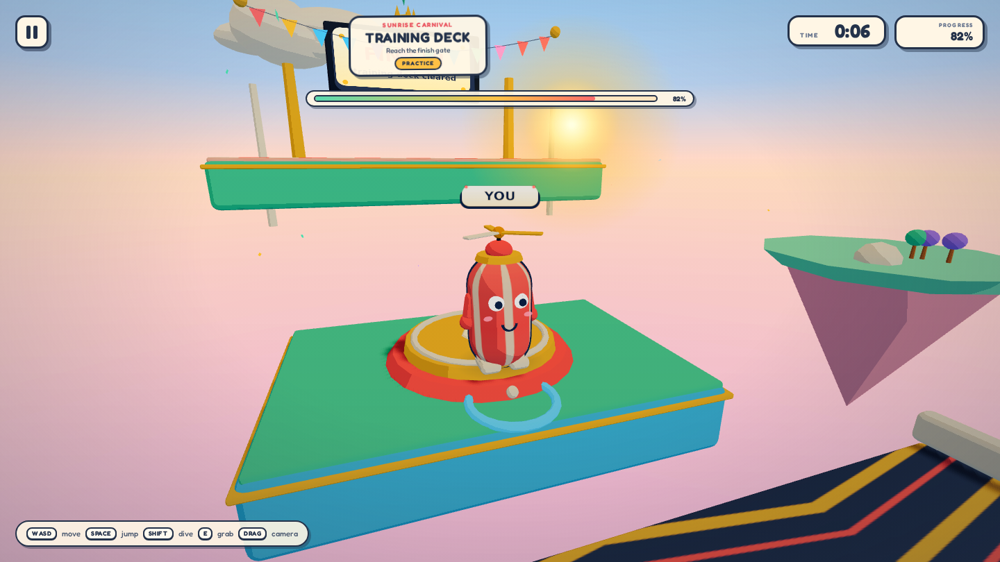

# Tumble Rush

A single-player 3D bean battle-royale party game for the browser. **Phase 1** ships a playable **Training Deck** vertical slice: run, jump, dive, grab and emote across a floating Sunrise Carnival course.



## Play

```bash
npm ci
npm run dev        # http://localhost:5173
```

WASD/arrows move, Space jumps, Shift dives, E grabs, Q emotes, mouse drag orbits, wheel zooms, Esc pauses. Touch joystick and buttons appear automatically on touch devices. The daily seed comes from the date; add `?seed=12345` to replay a specific deck.

## Commands

| Command | What it does |
| --- | --- |
| `npm run dev` | Vite dev server |
| `npm run build` | Production build (Pages base when `GITHUB_PAGES=true`) |
| `npm run preview` | Preview the production build |
| `npm run test` | Vitest unit tests |
| `npm run test:e2e` | Playwright smoke + hero screenshot |
| `npm run check` | Typecheck + unit tests + production build |

## What is implemented

- Vite 8 + strict TypeScript 5 + Three.js 0.186, bundled Fredoka font, design-token CSS.
- Seeded mulberry32 RNG, fixed 1/60 physics with capsule-vs-OBB/cylinder collide-and-slide, moving-platform carry, conveyor, bounce pad, kill plane, bean shoves.
- Procedural jelly-bean character with patterned skin, face, hat, arms/feet, outline, contact shadow and idle/run/jump/land/dive/stumble/grab/emote animation.
- Third-person camera with orbit, zoom, look-ahead, collision, FOV kick, shake and menu/celebration orbits.
- Keyboard, mouse drag, gamepad and touch input; no input sticks after focus loss.
- Training Deck course: start platform, gap, wall, moving platform, conveyor, bounce pad, raised finish gate, checkpoint respawns and Sunrise Carnival dressing.
- `window.__tumble` dev/test hook (`state`, `seed`, `playerPos`, `cameraPos`, `grounded`, `quality`, `setQuality`, `teleport`).
- CI checks Playwright on every PR; Pages deploy on `main`.

## Architecture

`src/game/` owns the renderer, fixed-step physics, bean, camera, input and level geometry. `src/app/` is DOM/CSS UI only. `src/test/` holds Vitest physics/RNG tests; `e2e/` holds Playwright smoke and evidence capture.

All geometry, textures and effects are generated in code. No runtime network requests, CDN assets or copied game assets. One bundled variable font is the only external asset.

## Status

TR-001, TR-002 and TR-003 are implemented on `feat/tumble-rush-v1`. The full three-round show, bots, UI suite, profile, audio and final deployment are phase 2+ work tracked in [`docs/TICKETS.md`](docs/TICKETS.md).

MIT licensed.
