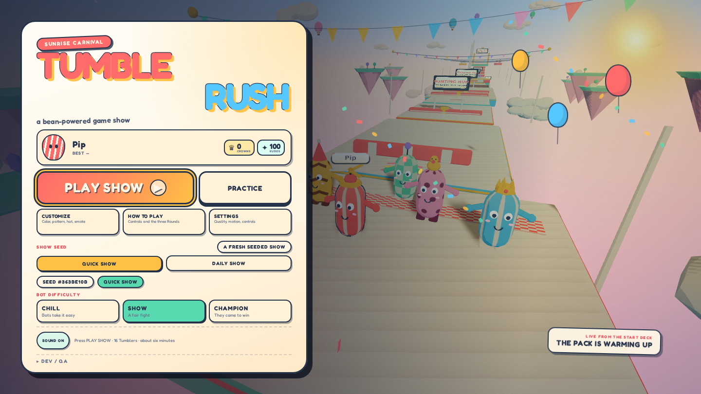
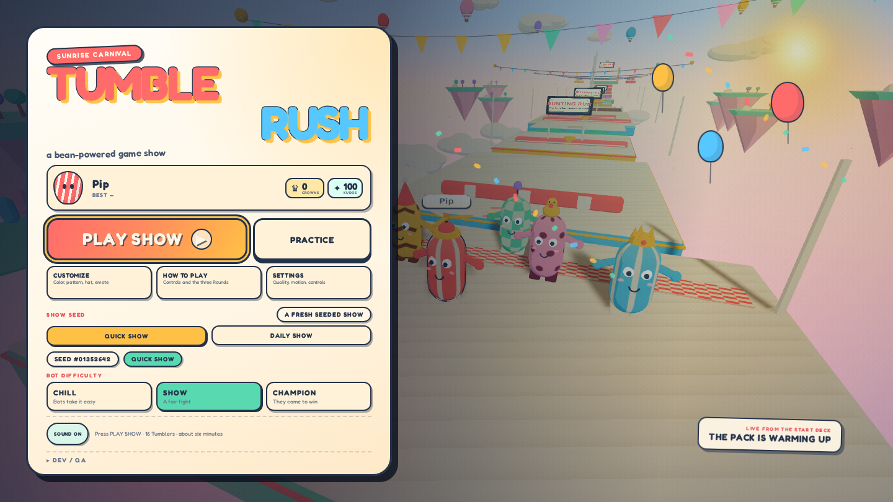
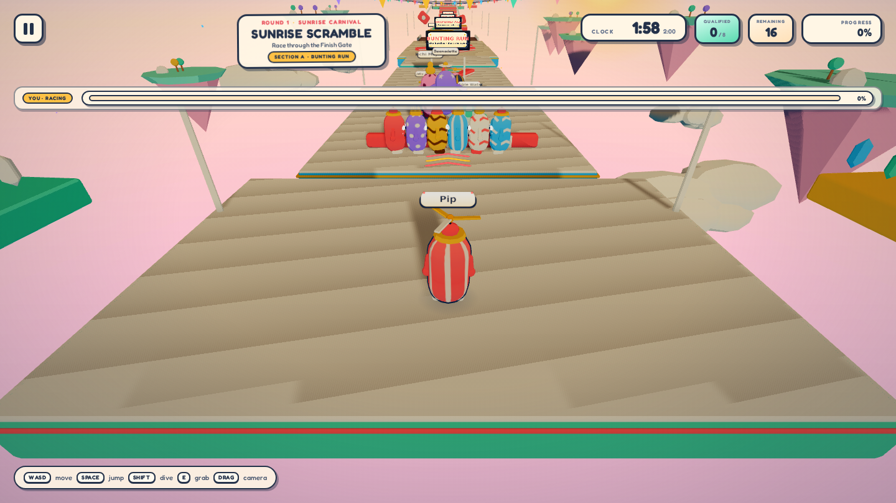
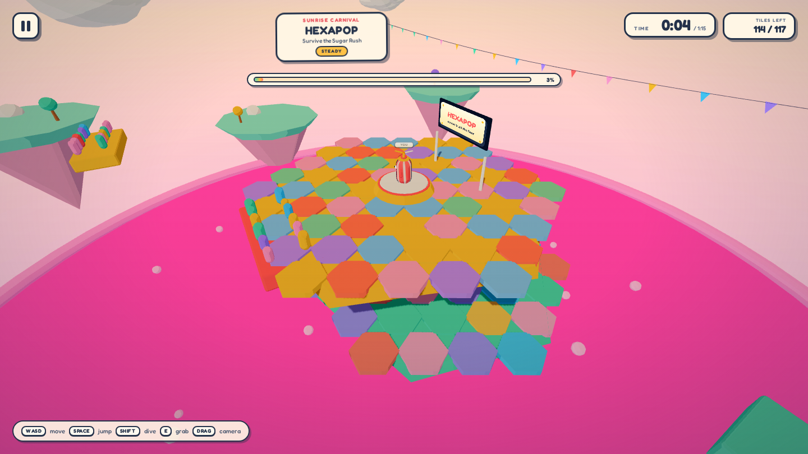
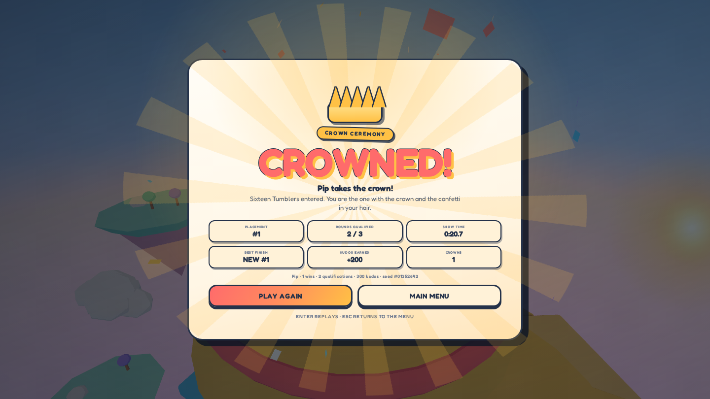

<div align="center">
  
  <h1>Tumble Rush</h1>
  <p><strong>A candy-coated 3D battle-royale party game for the browser.</strong><br />
  16 Tumblers. Three rounds. One crown.</p>
  <p>
    <a href="https://gerrcass.github.io/tumble-rush-game/"><strong>▶ PLAY TUMBLE RUSH</strong></a>
    &nbsp;·&nbsp;
    <a href="https://github.com/gerrcass/tumble-rush-game/actions/workflows/deploy.yml">Deployment</a>
    &nbsp;·&nbsp;
    <a href="docs/SPEC.md">Spec</a>
  </p>
</div>



Tumble Rush is an original, single-player 3D party battle royale. You are one of 16 jelly-bean **Tumblers** in a sunrise-carnival game show: race a seeded obstacle course, survive a collapsing honeycomb arena, then climb a rising-slime tower to take the crown. Every model, texture, particle, and note of music is generated in code.

**No installs. No accounts. No network calls at runtime.** Open the link and play.

## The show

| Round | Mode | Field | Advance | The idea |
| --- | --- | --- | --- | --- |
| 1 | **Sunrise Scramble** | 16 | Top 8 finishers | Five obstacle sections, rotating sweepers, pendulums, jelly jumps, pushers and a raised Finish Gate. |
| 2 | **Hexapop** | 8 | Last 4 standing | Three honeycomb tiers over pink slime. Every tile warns, then drops. Sugar Rush eats the arena from the outside in. |
| 3 | **Crown Climb** | 4 | First to the crown | A vertical spiral of rotating beams, rising donuts and pendulums while candy slime climbs below. |

A full show takes about 6–9 minutes. Qualifying earns **kudos**; winning earns a **crown**. Kudos unlock colors, patterns, hats, and emotes in the live 3D Customize screen. Everything is stored locally in your browser.

## Features

- **16-contestant show** — 15 named AI Tumblers with their own looks, skill, reaction time, mistakes, and shoves. Bots use the same controller and physics as you; they can qualify and win.
- **Three distinct rounds** — a seeded obstacle race, a collapsing-tile survival arena, and a vertical final.
- **Physical comedy** — coyote time, jump buffering, committed dives, grabs and shoves, stumble wobbles, splats, confetti, and a crown ceremony.
- **Designed front-end** — main menu, live customization, settings, how-to-play, round intros, countdown, HUD, pause, results, spectate, victory, defeat, and error states.
- **Procedural art and audio** — toon-shaded candy geometry, generated pattern textures, instanced confetti, and a Web Audio soundtrack/SFX suite with separate music and effects buses.
- **Desktop and touch** — keyboard + mouse, gamepad, and a touch joystick with jump/dive/grab/emote buttons. Responsive down to 390×844.
- **Accessible by default** — keyboard routes, visible focus, ARIA live announcements, reduced motion, name-tag toggle, and independent audio controls.
- **Local progression** — versioned profile, safe corrupt-data recovery, kudos economy, cosmetic unlocks, best finish, and a daily seeded show.
- **Tested and deployed** — 95 Vitest unit tests, 43 Playwright checks, CI on every PR, and GitHub Pages deployment from `main`.

## Play

**Live:** <https://gerrcass.github.io/tumble-rush-game/>

Or run it locally:

```bash
npm ci
npm run dev        # http://localhost:5173
```

Node 22+ and a WebGL2 browser are required. Add `?seed=12345` to replay a specific show; `?seed=` is ignored by the Daily Show, which uses the calendar date.

## Controls

| Action | Keyboard / mouse | Gamepad | Touch |
| --- | --- | --- | --- |
| Move | WASD / arrows | Left stick | Left joystick |
| Camera | Mouse drag | Right stick | Drag the scene |
| Jump | Space | A / cross | JUMP |
| Dive | Shift / right click | B / circle | DIVE |
| Grab / shove | E / left click | X / square | GRAB |
| Emote | Q | Y / triangle | EMOTE |
| Pause | Esc | Start | Pause button |

Coyote time and jump buffering make the platforming forgiving; dives are committed, so a missed dive is supposed to be funny. If you fall, you spectate the rest of the round and can skip to results. Practice mode adds checkpoint respawns and no elimination.

## Screens

| Menu | Sunrise Scramble |
| --- | --- |
|  |  |

| Hexapop | Crown ceremony |
| --- | --- |
|  |  |

More evidence lives in [`docs/evidence/`](docs/evidence/).

## Architecture

```text
src/
├── app/                 DOM/CSS screens, HUD, overlays, 3D preview
├── game/
│   ├── audio/           procedural Web Audio music and SFX
│   ├── bots/            same-physics bot brains
│   ├── levels/          Course, Hexapop, Crown Climb, Training Deck
│   ├── match/           contestants, show director, qualification
│   ├── physics/         fixed-step capsule world and colliders
│   ├── player/          bean, controller, camera rig
│   ├── profile.ts       versioned localStorage profile/economy
│   └── Game.ts          renderer, loop, input, show lifecycle
├── test/                Vitest unit tests
e2e/                     Playwright show, mobile, evidence and review tests
docs/                    spec, tickets, decisions, reviews, evidence
```

- **Vite 8 + TypeScript 5 (strict) + Three.js 0.186.**
- **Custom fixed-step physics** at 1/60 s: capsule-vs-OBB/cylinder, collide-and-slide, moving-platform carry, conveyor surfaces, bounce pads, hazard impulses, and bean-vs-bean capsule collision. No general rigid-body engine.
- **Deterministic content** — every layout decision comes from a seeded mulberry32 RNG; the daily show uses the date.
- **Original assets only** — geometry, canvas textures, particles, and audio are generated at runtime. The only external asset is the bundled open-license Fredoka variable font.
- **Quality budgets** — the 1440×810 Course start measures **243 draw calls / 117,160 triangles** on high quality, inside the 250 / 120k budget. The development host is SwiftShader-only, so the 55 fps hardware target is validated by draw-call/triangle budgets here and must be checked on real hardware.

## Development

| Command | What it does |
| --- | --- |
| `npm run dev` | Vite dev server |
| `npm run build` | Production build (`GITHUB_PAGES=true` for the Pages base path) |
| `npm run preview` | Preview the production build |
| `npm run test` | Vitest unit tests |
| `npm run test:e2e` | Playwright show, mobile, review, and evidence suite |
| `npm run verify:show` | Real 16-bean Course + Hexapop spawn release gate |
| `npm run check:release` | Typecheck, unit tests, build, and focused review specs |
| `npm run check` | Typecheck + unit tests + production build |

The dev/test-only `window.__tumble` hook exposes show state, contestant statuses, standings, seeded `simulate(seconds)`, round jumps, camera framing, audio state, and render info. It is used by the Playwright suite and is not part of normal play.

## Deployment

GitHub Actions runs CI on pull requests and deploys `main` to GitHub Pages with `GITHUB_PAGES=true`. The public URL is <https://gerrcass.github.io/tumble-rush-game/>. Pages source: GitHub Actions.

## Credits

Tumble Rush is an original project inspired by the party-royale genre popularized by *Fall Guys*. It is not affiliated with, endorsed by, or containing assets from Mediatonic, Epic Games, or *Fall Guys*. All game art, code, and audio in this repository are original and generated by the project.

Built with [Three.js](https://threejs.org/), [Vite](https://vite.dev/), and [Fredoka](https://github.com/googlefonts/fredoka) (SIL Open Font License).

## License

MIT. See [LICENSE](LICENSE).
